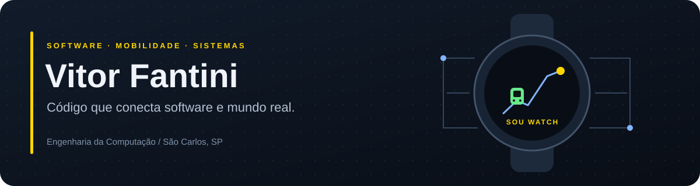

  

  <strong>Back-end · Android / Wear OS · Sistemas embarcados</strong>

  
  
  

## Olá, sou o Vitor 👋

Sou de **São Carlos, SP**, e estudante de **Engenharia da Computação na UNICEP**. Gosto de criar aplicações que resolvem problemas do dia a dia e de entender o que acontece entre a interface, os dados e o dispositivo.

Tenho interesse em **back-end e sistemas embarcados**. No meu TCC, venho explorando desenvolvimento para **Android e Wear OS**, integração com APIs e os desafios de levar informação útil para uma tela pequena.

## Projeto em destaque

### ⌚ [SOU Watch](https://github.com/VitorFantini/SOU-Watch)

**O transporte de São Carlos, direto no pulso.**

Aplicativo para smartwatches Wear OS desenvolvido como projeto de TCC. Permite consultar horários, escolher uma parada e acompanhar o ônibus associado à viagem.

| Informação útil | Cuidado com a experiência |
| :--- | :--- |
| Linhas **01, 06 e 32**, com sentidos e horários | Interface pensada para telas pequenas |
| Distância pelo trajeto e minutos estimados | Idade do GPS visível e tratamento de posições antigas |
| **Tile Meu ponto** para consultar a parada favorita | Atualizações controladas e atenção ao consumo de energia |
| Google Maps opcional, com chave própria | Mapa local como alternativa |

  
  

  <a href="https://github.com/VitorFantini/SOU-Watch"><strong>Explorar o projeto →</strong></a>
  &nbsp;·&nbsp;
  <a href="https://github.com/VitorFantini/SOU-Watch#como-instalar-no-seu-smartwatch">Como instalar</a>
  &nbsp;·&nbsp;
  <a href="https://github.com/VitorFantini/SOU-Watch/releases">Versões publicadas</a>

> Projeto acadêmico independente do aplicativo oficial SOU. Os minutos são estimativas; a validação de precisão em campo faz parte da evolução do projeto.

## Tecnologias que uso e estudo

  
  
  
  
  
  

Uso **Kotlin e Jetpack Compose** na interface do relógio, **APIs HTTP** para integrar dados e **Python** em ferramentas de testes e análise. No desenvolvimento do SOU Watch, também trabalho com testes automatizados, recuperação de falhas e documentação.

## O que estou construindo agora

- Concluindo e refinando o **SOU Watch**, meu projeto de TCC.
- Estudando o equilíbrio entre atualização dos dados, usabilidade e bateria em smartwatches.
- Preparando a validação das estimativas de chegada com observações em campo.

---

  <strong>Vamos conversar sobre software?</strong> 
  <a href="mailto:vitormf3003@gmail.com">vitormf3003@gmail.com</a>

